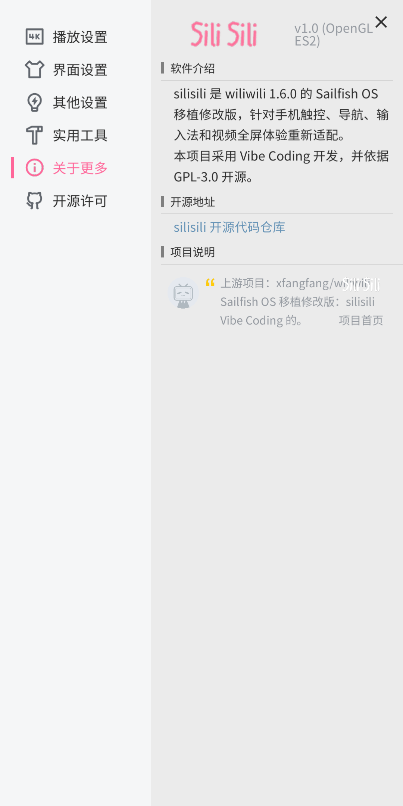

<p align="center">
  
</p>

# silisili

`silisili` 是 [wiliwili 1.6.0](https://github.com/xfangfang/wiliwili) 的 Sailfish OS 移植修改版，面向手机触控操作重新适配。首个公开版本为 `v1.0`。

本项目采用 Vibe Coding 开发，并依据 GPL-3.0-or-later 开源。

## 实机界面

<p align="center">
  
  
  
</p>

## 功能

- 参考 Bilibili 移动端的信息结构，提供首页、动态、搜索、个人页、播放、评论和推荐。
- 使用 Sailfish 页面栈与返回逻辑，提供固定底部主导航，不包含“打开 App”等网页推广控件。
- 所有文字和数字输入均接入 Sailfish Maliit 输入法，并提供触控返回和确认按钮。
- 横屏视频进入横屏全屏，竖屏视频保持竖屏；播放器保持媒体比例，不拉伸画面。
- 支持播放器触控手势、评论分页、下拉刷新和前台播放保持亮屏。
- 首次启动时，仅在新配置不存在的情况下，将 `~/.config/wiliwili` 私密复制到 `~/.config/silisili`。

## 安装

从 `v1.0` Release 下载同一个 AArch64 Sailfish RPM，可用于 Sailfish OS 5.0
和 5.1：

```text
silisili-sailfish-1.0.0-7.aarch64.rpm
SHA-256: db88e1f206c4ee519219df76b1a5be0125a5c2893709b90fb2b34227765e1ed5
```

新包会替换旧的 `wiliwili-sailfish` 包，但保留旧配置目录作为迁移来源。应用运行路径为 `/usr/bin/silisili`，桌面 ID 为 `cn.silisili.app`。

该包以 Sailfish OS `5.0.0.62` SDK 为最低编译基线，并在 Pixel 3a XL
的 Sailfish OS `5.1.0.11` 上做实机验证。5.0 当前完成 SDK、依赖和 ABI
兼容校验，不标注为 5.0 真机测试。

`1.0.0-7` 不再把移动 Web 的 `vmin` 比例直接套到整套界面，而是按
Android/iOS 原生客户端的视觉层级分别校准：正文约 16pt，辅助文字约
12–14pt，底部导航约 12pt，可视图标约 24–28pt，触控目标约 48–56pt。
设置侧栏、弹窗、播放器顶栏、进度条和清晰度菜单也按手机可用宽度重新
排布，打开后不会越出屏幕。返回手势仅从系统边缘内侧的窄区起手，避免
与直播和视频横向手势冲突。切换普通视频或直播清晰度时，会保持当前
播放或暂停状态。
不同分辨率和长宽比按物理短边重排；可信的 Wayland 屏幕毫米尺寸会用于
有上下限的 DPI/物理尺寸修正，缺失或可疑数据则安全回退到分辨率短边。
重复切换横屏后，窗口仍恢复为 1080×2160。

## 构建

仓库已经收录完整依赖源码，包括本移植修改过的 Borealis 和 GLFW，不需要初始化 Git 子模块。常规 CMake 构建：

```sh
cmake -S . -B build -G Ninja \
  -DPLATFORM_DESKTOP=ON \
  -DINSTALL=ON \
  -DCMAKE_BUILD_TYPE=Release \
  -DCMAKE_INSTALL_PREFIX=/usr \
  -DGLFW_BUILD_WAYLAND=ON \
  -DGLFW_BUILD_X11=OFF \
  -DUSE_GLES2=ON \
  -DUSE_EGL=ON \
  -DSILISILI_SAILFISH_MOBILE=ON
cmake --build build
```

工具链、RPM 复现条件和校验方式见 [BUILDING.md](BUILDING.md)。完整基线、依赖版本和补丁哈希见 [UPSTREAM.md](packaging/apps/silisili/UPSTREAM.md)。
Sailfish OS 5.0 ABI 校验与 5.1 真机回归记录见
[docs/SAILFISH_5X_VALIDATION.md](docs/SAILFISH_5X_VALIDATION.md)。

## 上游与许可

本项目派生自 `xfangfang/wiliwili`，上游作者的版权声明不会因 fork 改名而改变。应用代码继续依据 [GPL-3.0](LICENSE) 发布；Borealis、GLFW、mpv、FFmpeg 及其他依赖分别遵循其自身许可证。

仓库不包含账号、Cookie、Token、服务凭据、DRM 绕过或专有解码器。

`silisili` 是非官方客户端，与哔哩哔哩及其关联公司没有隶属或认可关系。Bilibili 名称及相关标识归其权利人所有。
