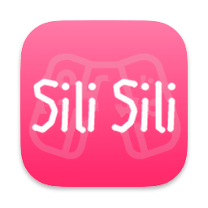
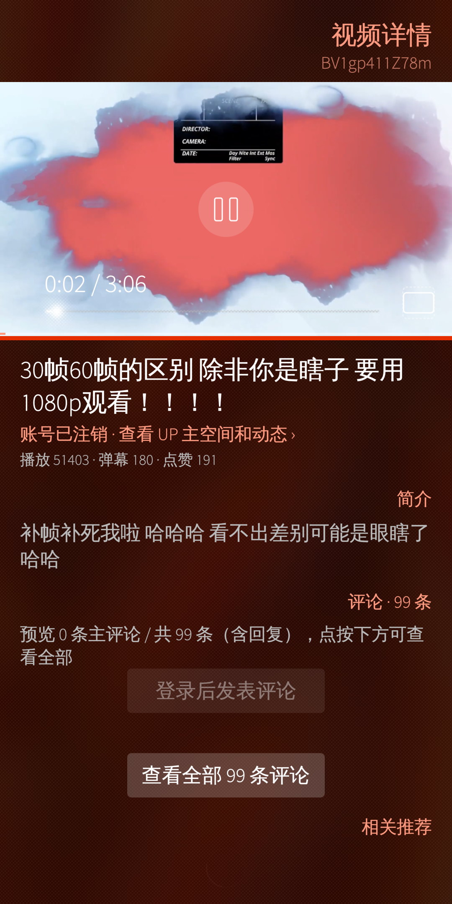
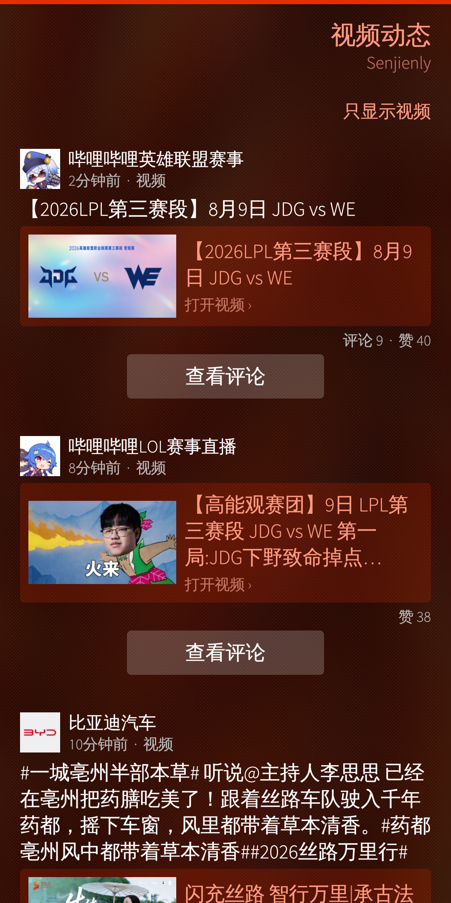
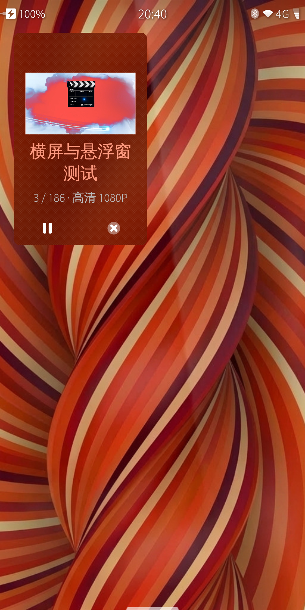
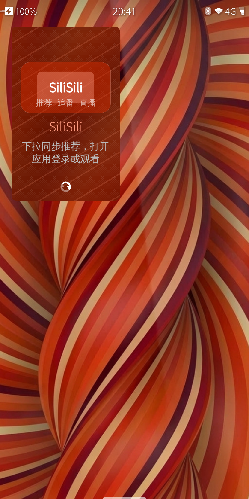
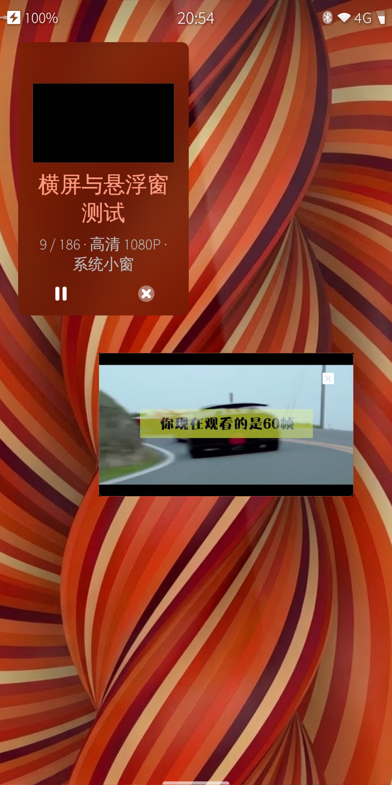
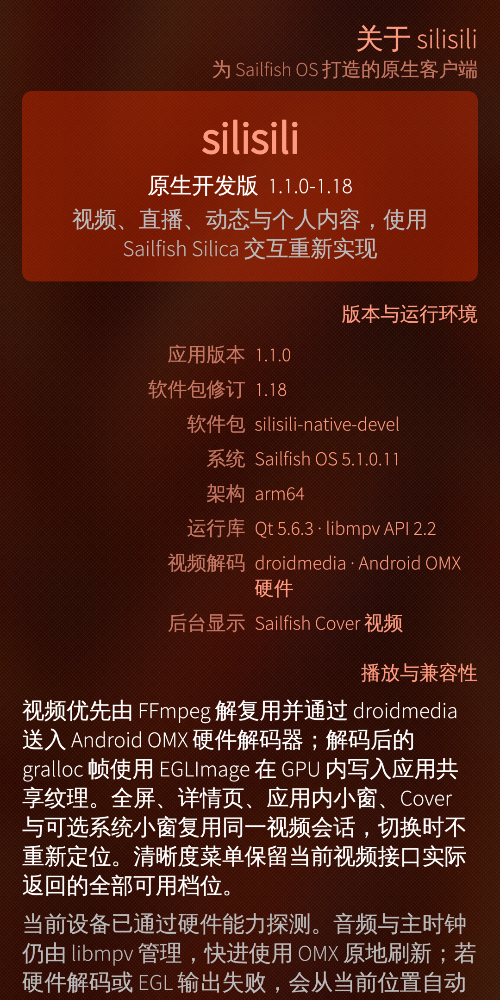
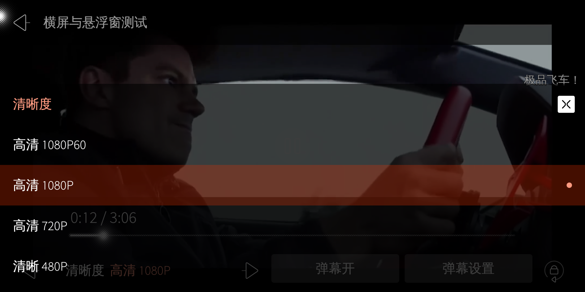

<p align="center">
  
</p>

<h1 align="center">silisili</h1>

<p align="center">
  为 Sailfish OS 重新实现的原生哔哩哔哩客户端
</p>

`silisili` 使用 Qt Quick、Sailfish Silica 和原生 C++ 数据模型重新实现手机端界面与播放链路。当前原生版不再是把电视端 UI 缩放到手机屏幕：页面栈、菜单、对话框、Cover、横竖屏布局、触控手势和后台呈现均按 Sailfish OS 的交互方式设计。

> [!IMPORTANT]
> 当前原生包仍是开发版本，并非哔哩哔哩官方客户端。接口、清晰度和账号内容会受到登录状态、账号权益、地区与上游服务变化影响。

## 项目状态

仓库目前保留两条可并行安装的产品线。后续开发以原生版为主，旧版仅用于行为对照和回退。

| | 原生开发版 | 旧版稳定包 |
| --- | --- | --- |
| 当前版本 | `1.1.0-1.40` | `1.0.0-7`（`v1.0`） |
| 软件包 | `silisili-native-devel` | `silisili-sailfish` |
| 可执行文件 | `/usr/bin/silisili-native` | `/usr/bin/silisili` |
| Desktop ID | `cn.silisili.native` | `cn.silisili.app` |
| 界面技术 | Sailfish Silica 原生页面 | wiliwili/Borealis 手机适配 |
| 安装关系 | 与旧版并行安装 | 独立保留 |

原生包使用自己的配置目录。首次安装且原生会话不存在时，只读导入旧版配置快照；不会覆盖或删除旧版配置。

## 原生版界面

以下截图于 2026-08-09 从 Pixel 3a XL / Sailfish OS 5.1 上安装的 `1.1.0-1.18` 原生包重新采集，不使用历史截图，也不是旧版 wiliwili/Borealis 界面。`1.1.0-1.40` 的网络、超高清保护、硬解冻结恢复、启播同步、直播真实分辨率和画质切换方向稳定性修复不改变这些页面布局。点击图片可查看原始分辨率。

<p align="center">
  <a href="docs/screenshots/native-readme/home.png"></a>
  <a href="docs/screenshots/native-readme/video-detail.png"></a>
  <a href="docs/screenshots/native-readme/dynamic.png"></a>
  <a href="docs/screenshots/native-readme/live-feed.png"></a>
</p>

<p align="center"><sub>首页推荐 · 1080P 视频详情与内联播放 · 视频动态 · 直播列表</sub></p>

<p align="center">
  <a href="docs/screenshots/native-readme/cover-playing.png"></a>
  <a href="docs/screenshots/native-readme/cover-idle.png"></a>
  <a href="docs/screenshots/native-readme/system-pip.png"></a>
  <a href="docs/screenshots/native-readme/about.png"></a>
</p>

<p align="center"><sub>播放中的实时视频 Cover · 未播放时的斜纹 Cover · 系统播放小窗 · 版本与兼容性说明</sub></p>

<p align="center">
  <a href="docs/screenshots/native-readme/quality-picker-landscape.png"></a>
</p>

<p align="center"><sub>横屏播放器与可滑动清晰度面板</sub></p>

## 主要功能

### 浏览与账户

- 首页推荐、分区排行、番剧/影视、直播列表与连续分页。
- 视频关键词、标题和 UP 主搜索，支持搜索历史与结果分页。
- 将视频动态与图文、专栏、转发等非视频动态分开浏览，并可打开动态正文。
- UP 主空间、头像、投稿和动态；图片请求带正确的来源信息并使用有界缓存，降低头像首次加载失败的概率。
- 二维码登录。Sailfish OS 5.2+ 运行时优先使用 `Amber.Barcode 1.0`，5.1 优先使用 `QrShareImage 1.0`，组件不可用时自动尝试另一实现。
- 二维码不会因轮询状态自行刷新；只有用户主动刷新或二维码 URL 确实改变时才重建。
- 历史记录、收藏夹、订阅合集、追番、追剧和稍后再看。
- 从历史记录进入视频时恢复到已记录位置，播放过程中持续上报进度。
- 主评论、回复楼层、发布评论、回复、点赞与取消点赞。
- 网络断开或 Wi-Fi/移动网络切换时立即释放旧请求；下拉刷新和分类切换会取消在途请求并隔离迟到回包，不再让页面长期停在加载状态。

### 视频、番剧与直播

- 普通视频、番剧/影视、直播和多 P 视频；当前分 P 播放完成后自动续播下一 P。
- 直播首次进入请求账号可用的原画档，而不是固定使用 `qn=250`；服务端降档后以真实 `current_qn` 为准。轨道按设备硬解能力选择 AVC/HEVC，播放控件同时显示服务端档位、实际分辨率与源帧率。
- 展示接口实际返回的全部清晰度档位，并按选择的精确 `qn` 请求 DASH 媒体；清晰度面板可滑动，不会因切换到低清后丢失高画质选项。
- 画质标签来自实际解析结果。1080P、1080P+ 和高帧率档位仍取决于账号权益及服务端是否返回对应视频轨道。
- 4K/8K 档位仍会完整展示；未验证 UHD 能力的设备默认安全选择真实 1080P60 硬解轨道，避免 OMX 耗尽连续内存后整机卡死。只有经过真机验证的适配才应启用 UHD 解码试运行。
- 弹幕分段加载、透明度、字号、速度和安全轨道布局。
- 播放/暂停、精确跳转、倍速、音量、亮度、进度条与当前/总时长同步。
- 横竖屏与全屏自适应，保持视频原始比例，不把横屏直播或后续视频过度拉伸；横屏全屏切换清晰度时保留上一张已确认视频比例，加载过程不会短暂切成竖屏 UI。
- 一个进程级播放会话在详情页、全屏、应用内小窗、Cover 与系统小窗之间复用，切换界面时不重新加载或隐藏定位。
- 硬解画面序列停止但音频时钟仍前进时，播放器会在约 3 秒后只重建同清晰度视频解码器；音频、进度、媒体加载和当前共享画面保持不变。
- 从历史位置或清晰度切换位置启播时，音频先在目标处暂停；只有目标时钟和第一张真实视频纹理都确认后才同步放行，避免声音先播放、随后画面重新定位。

### Sailfish OS 集成

- 使用 `ApplicationWindow`、`PageStack`、`SilicaListView`、`PullDownMenu`、`ContextMenu` 和原生 Dialog。
- 支持 Sailfish 边缘返回、Maliit 输入法、设备方向传感器和前台播放保持亮屏。
- 后台显示可在“Cover 播放”和“系统小窗播放”之间配置，两种模式不会同时绘制。
- Cover 在播放时显示实时视频画面；未播放时显示轻量的品牌斜纹背景和状态信息。
- 系统小窗使用 Lipstick notification 表面：可拖动、记忆位置、跟随设备方向，点按返回播放页；视频之外的透明区域保持点击穿透。
- 锁屏、熄屏、停止播放或自然播放完成时自动隐藏系统小窗；关闭按钮停止播放并保留足够的触控区域。

## 播放架构

原生版把“解码”和“显示位置”分开。前台、Cover 与 PiP 只是在不同的 Sailfish 表面采样同一张应用共享纹理，不会为切换显示位置重建播放器。

```text
Bilibili playurl / DASH
        │
        ├─ FFmpeg 解复用 ─ droidmedia / Android OMX 硬解
        │                        │
        │                 gralloc + EGLImage
        │                        │
        └─ libmpv / FFmpeg 软解回退
                                 │
                      应用共享 OpenGL 视频纹理
                                 │
             ┌──────────┬────────┴────────┬──────────┐
           详情页       全屏           Cover       系统 PiP
```

- 硬解路径使用 `droidmedia` 的 `HW_ONLY` 能力探测；音频、主时钟和播放状态仍由 libmpv 管理。
- 解码后的 gralloc 帧通过 EGLImage 留在 GPU 内，不经过整帧 CPU 拷贝。
- droidmedia 回调不再等待显示队列；启动/定位阶段保留硬解重排序窗口，到达目标帧后使用有界滑动队列，避免 Binder 回调堆积和批量丢帧。
- 硬解、EGL 输出或设备能力不可用时，会从当前位置降级到完整的 libmpv/FFmpeg 软件解码。
- 快进在硬解路径中刷新现有解码器；切换画质、前后台或呈现表面不应只移动音频而留下旧帧。

详细设计见 [原生架构说明](docs/NATIVE_SAILFISH_ARCHITECTURE.md)。

## 兼容性

当前 RPM 仅面向 AArch64 Sailfish OS 设备。

| 环境 | 当前状态 |
| --- | --- |
| Sailfish OS `5.0.0.62` SDK | 原生包的最低编译、依赖与 ABI 基线；尚未声明 5.0 真机完整验证 |
| Pixel 3a XL / Sailfish OS `5.1.0.11` | 当前完整实机开发和回归环境 |
| Sailfish OS 5.2 | 已实现 `Amber.Barcode`/`QrShareImage` 运行时兼容；完整设备回归仍需按具体机型执行 |

硬件解码依赖设备提供可用的 Android 媒体栈、`droidmedia` 与 libhybris EGL/GLES；硬解条件不满足时由播放器使用软件解码兼容路径。系统 PiP 另行依赖 Lipstick notification 表面和软件包声明的权限，不可用时应选择 Cover。

## 安装

### 原生开发版

当前 `1.1.0-1.40` 已通过 Pixel 3a XL / Sailfish OS 5.1.0.11 真机门禁，尚未作为正式 GitHub Release 发布。构建完成后，将 RPM 复制到手机并在已启用开发者模式的设备上安装：

后续每次 GitHub 原生版本更新都会同时在 [GitHub Releases](https://github.com/ZeroX-S/silisili/releases) 发布经过真机回归的 AArch64 RPM 和 SHA-256 校验文件，不再只推送源码。

```sh
devel-su rpm -Uvh --replacepkgs \
  /home/defaultuser/Downloads/silisili-native-devel-1.1.0-1.40.aarch64.rpm
```

本轮真机回归使用的 AArch64 RPM SHA-256 为
`ad19d38a6aaf0a3c9cc86a9fbf12641f77a48f9bb3630a61f62ea713e86f3c64`。

安装脚本会启用原生版硬解所需的最小兼容服务。原生包不会替换 `silisili-sailfish`，因此两版可以同时保留。

### 旧版稳定包

旧版可从 [v1.0 Release](https://github.com/ZeroX-S/silisili/releases/tag/v1.0) 下载：

```text
silisili-sailfish-1.0.0-7.aarch64.rpm
SHA-256: db88e1f206c4ee519219df76b1a5be0125a5c2893709b90fb2b34227765e1ed5
```

## 构建

### 1. 校验原生源码清单

每次构建或提交前先运行：

```sh
bash vm-deploy/scripts/verify-silisili-native-source.sh
```

校验会检查 RPM、CMake 与 qmake 版本是否一致、源码和 QRC 清单是否闭合、桌面入口是否为生产配置，以及 Cover/系统 PiP 配置是否仍被正确接入。

### 2. 构建 AArch64 RPM

构建脚本默认使用 `SailfishOS-5.0.0.62-aarch64` target 和 `SailfishOS-5.0.0.62-i486` tooling。除了 Sailfish SDK，还需要已经验证的私有 libmpv/FFmpeg 运行库、ARM32 minimedia ABI shim，以及一份包含对应运行库许可文件的旧原生 RPM：

```sh
export PROJECT_ROOT="$PWD"
export BUILD_ROOT="$HOME/silisili-native-build"
export OUTPUT_DIR="$HOME/silisili-native-artifacts"
export SILISILI_MPV_PREFIX="/path/to/validated/silisili-runtime"
export SILISILI_MINIMEDIA_SHIM="/path/to/libminimedia-audiosource-shim.so"
export SILISILI_RUNTIME_LICENSE_RPM="/path/to/audited/silisili-native-devel.rpm"

bash vm-deploy/scripts/build-silisili-native-rpm.sh
```

产物写入 `$OUTPUT_DIR/silisili-native-devel-1.1.0-1.40.aarch64.rpm`。脚本会验证 AArch64/PIE、私有 RPATH、运行库清单、minimedia shim ABI、许可证载荷和最终 RPM 身份。

旧版 wiliwili/Borealis 构建方式仍保留在 [BUILDING.md](BUILDING.md)，但不适用于当前原生客户端。

## 验证基线

已安装的 `1.1.0-1.40` 在 Pixel 3a XL / Sailfish OS `5.1.0.11` 上完成直播真实 1080p 最终呈现、直播多档切换、横屏全屏点播画质切换和 60 秒硬解门禁；并继承 1.39 已通过的 Cover/系统 PiP、退出资源回收，以及 1.38 的完整点播清晰度、1080P60/4K/8K 安全降级、历史位置、网络恢复和 gralloc/ION/CMA 生命周期回归。测试不依赖截图内容推断。

- 冷启动直播以应用档位 `0` 请求服务端 `qn=10000`。真机确认解码输入为 `1920×1080@60`，全屏共享纹理为 `2160×1080`，有效视频视口为完整 `1920×1080`，不再把原画压到旧的 800 像素共享表面；画质标签按真实 `current_qn`、解码分辨率、源帧率和最终呈现更新。
- 当前测试直播间广告 `qn=10000,400,250` 三档；自动循环从原画切到 `qn=250` 后，物理暂停/继续和连续 60 秒播放均在同一 PID 内通过，帧序号从 61 推进到 1861，测得 `29.82 fps`，无软件回退。
- 横屏全屏点播通过真实可滑动画质面板从 `1080P+ (qn=112)` 切到 `1080P (qn=80)`；播放器页始终保持 `2160×1080` 横屏布局，加载期间没有竖屏布局、进程重建或硬解回退。直播画质切换同样保留已确认的 `1.7778` 显示比例。
- `PlaybackSession` 统一持有一个进程级播放器、前台表面、Cover/系统 PiP 与恢复流程；普通视频、PGC 和直播仍分别保留各自解析、清晰度、历史/进度和可定位能力。直播不写点播历史、不允许 seek/倍速，点播不使用直播 QN。
- 直播 Cover 实时帧从 37 推进到 67；直播系统 PiP 被识别为 `mediaKind=live`。两种后台模式都沿用同一解码器、只有一次媒体加载，返回前台没有隐藏 seek、后台暂停或软件回退。普通 VOD Cover 帧从 91 推进到 121，系统 PiP 连续两轮也没有低于 45fps 或重映射闪现。
- 历史位置 `14s` 连续启播三次，每次只有一个媒体加载；目标时钟和第一张真实纹理确认前音频保持暂停，没有先声后画后的二次定位，也没有误触发软件回退。媒体命令至首帧最大 `1675 ms`，完整请求至首帧最大 `1966 ms`。
- Android OMX 硬解、gralloc/EGLImage 共享纹理，CPU 整帧拷贝为 `0`，未触发软件回退。
- 连续 6 次注入“画面冻结、音频继续”后，同一 PID 内只把视频解码 generation 从 1 重建到 7；音频重载为 0、媒体加载仍为 1、旧纹理保留，恢复后 30fps 片源实测 `30.12 fps`。每一代 droidmedia/gralloc 引用均在工作线程退出后成对释放。
- 1080P60 连续 60 秒的 63 个稳定显示窗口最低 `55.773 fps`，硬解回调丢帧与队列压力均为 0。
- 真机依次切换测试片源实际提供的 `360P/480P/720P/1080P/1080P+`（`qn=16,32,64,80,112`），6 个解码代际全部完成引用平衡；切换保持同一进程、播放位置和完整清晰度目录。
- Cover、前台与系统 PiP 使用同一解码器、同一媒体加载和同一播放时钟。
- 系统 PiP 经过横竖方向、拖动与位置持久化、锁屏隐藏/解锁恢复、点按返回和连续两轮后台/恢复回归。
- PiP 返回前台时没有重复加载、隐藏 seek 或中间重映射闪现；关闭按钮只显示主题关闭图标，不再覆盖半透明圆形背景。
- 应用在后台系统 PiP 可见时关闭，会先停止 PiP 计时器、清空输入区域并释放 notification/QQuickView，再停止播放会话和硬解/GL 后端；真机退出后应用进程、PiP overlay 和播放进程计数均为 0。
- 一次性网络切换回归在首个请求失效后立即退出 loading，同一 PID 的新请求成功；随后普通生产入口首页加载完成，`rpm -V` 和 QML 错误扫描均保持干净。
- 首页正在滑动时物理关闭 Wi-Fi 后，应用保持同一 PID，后续 12 次触控滑动全部成功、内容位置推进到 `6398` 且没有离线请求风暴；恢复网络后首页能继续刷新。独立 64 次快速分页恢复门也在同一 PID 完成。
- 4K/8K 请求在当前未验证 UHD 的设备上都安全解析到真实 1920×1080/60 硬解；4K 请求从历史位置 `14s` 启播，加载状态正常结束，物理触控暂停/恢复均可用，没有 UHD OMX 分配、软件解码回退、帧队列堵塞或 CMA 耗尽。

完整历史记录、边界和已知限制见 [真机验证记录](docs/NATIVE_DEVICE_VALIDATION.md)、[迁移矩阵](docs/NATIVE_MIGRATION_MATRIX.md) 与 [测试部署工具说明](docs/NATIVE_TESTING_TOOLS.md)。
GitHub RPM 的版本、摘要、标签和发布门禁见 [原生 RPM 发布流程](docs/NATIVE_RELEASE_PROCESS.md)。

## 目录结构

| 路径 | 内容 |
| --- | --- |
| `native/src/` | 原生 C++ 数据模型、API、播放会话、硬解和系统 PiP |
| `native/qml/` | Sailfish Silica 页面、组件、Cover 与 PiP 窗口 |
| `packaging/apps/silisili-native/` | 原生 RPM、桌面入口、权限、服务与上游署名 |
| `vm-deploy/scripts/` | SDK 构建、源码校验、部署和设备回归工具 |
| `docs/NATIVE_*.md` | 原生架构、迁移进度和真机验证记录 |
| 仓库根目录的旧 C++ 源码 | `1.0.x` wiliwili/Borealis 移植，作为旧版保留 |

## 已知边界

- 原生包仍以 `-devel` 名称发布，接口和交互可能继续调整。
- Sailfish OS 5.0 当前只有 SDK/ABI 验证；5.2 的完整真机矩阵尚未闭合。
- 服务端可能按账号、地区、风控或版权限制返回不同的动态、评论、直播、番剧和清晰度结果。
- 并非所有设备都有可用的 droidmedia 硬解或 Lipstick 系统 PiP 能力；软件回退和 Cover 是兼容路径。

## 上游与许可

原生客户端建立在早期 [wiliwili](https://github.com/xfangfang/wiliwili) Sailfish 移植积累之上。应用代码继续依据 [GPL-3.0-or-later](LICENSE) 发布；Qt、Sailfish Silica、libmpv、FFmpeg、droidmedia、libhybris 及其他依赖分别遵循其自身许可证。

直接硬解与共享纹理方案参考并改造自 [RooTheater-SailfishOS](https://github.com/RootGPT-YouTube/RooTheater-SailfishOS)，系统 PiP 的 Lipstick notification 表面和输入区域机制参考 [screentapshot-lipstick](https://github.com/CODeRUS/screentapshot-lipstick)。具体署名随 RPM 安装，并保存在：

- [`NOTICE.RooTheater`](packaging/apps/silisili-native/NOTICE.RooTheater)
- [`NOTICE.ScreenTapShotLipstick`](packaging/apps/silisili-native/NOTICE.ScreenTapShotLipstick)

仓库不包含账号、Cookie、Token、服务凭据、DRM 绕过或专有解码器。

`silisili` 与哔哩哔哩及其关联公司没有隶属、认可或合作关系。Bilibili 名称及相关标识归其权利人所有。
